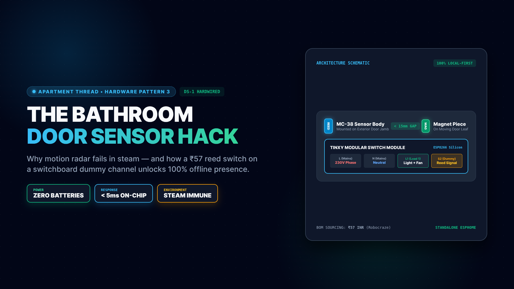
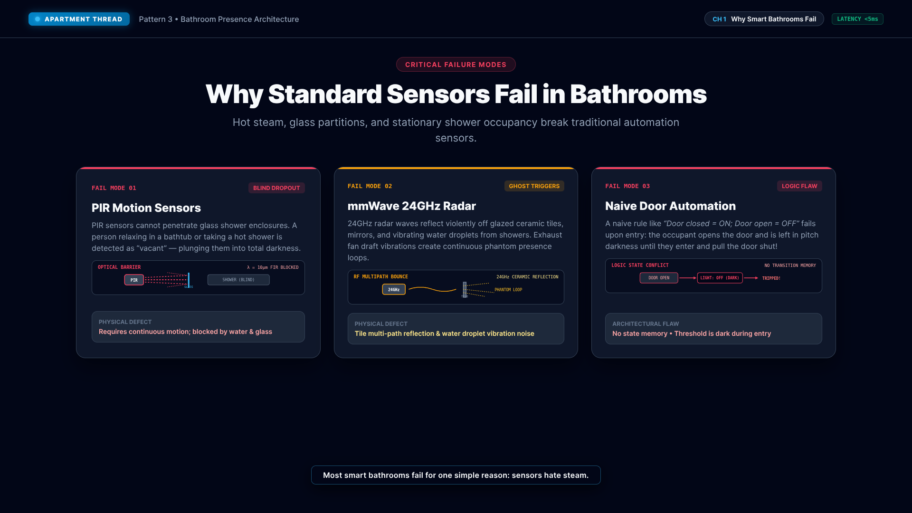
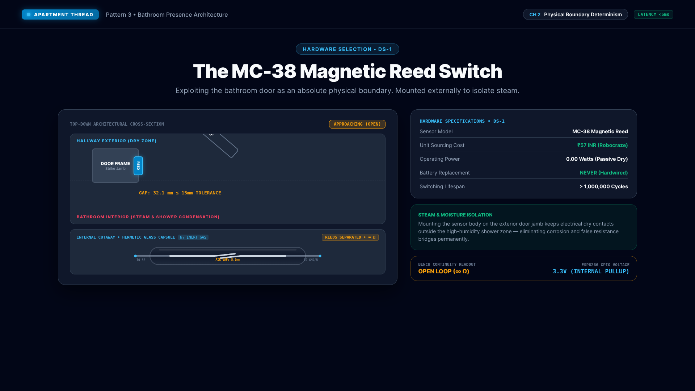
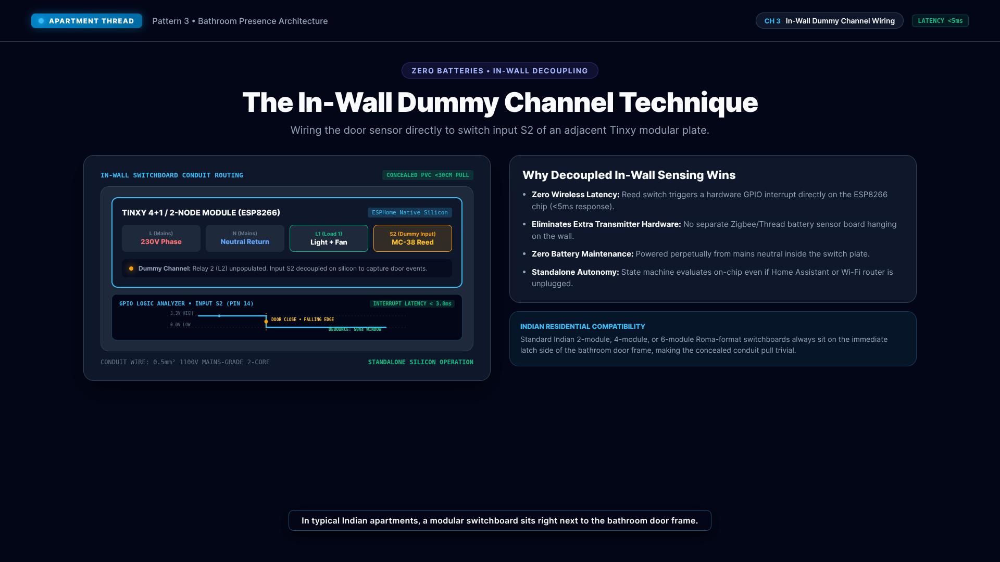
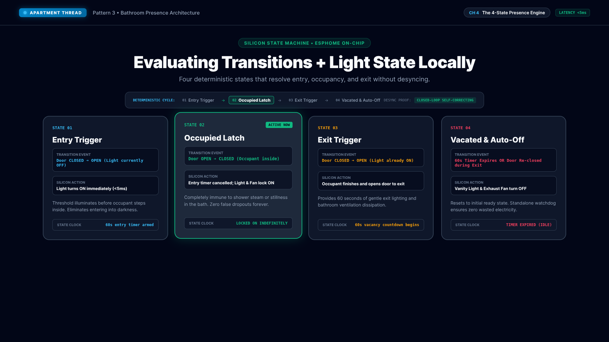
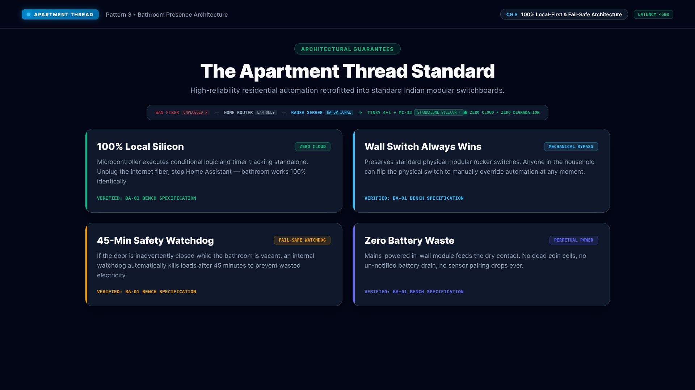

# The Bathroom Pattern: Door Magnetic Sensor & Sub-5ms Presence



YouTube explainer video for the **ApartmentThread** home automation architecture, explaining why traditional motion sensors fail in humid bathrooms and how an in-wall switchboard "dummy channel" with a passive MC-38 magnetic reed switch solves bathroom presence deterministically.

## YouTube Video Metadata

### Title
How to Automate Bathroom Lighting without Motion Sensors | Apartment Thread

### Video Tags
`smart home`, `home automation`, `apartment thread`, `matter over thread`, `esphome`, `tinxy`, `door sensor`, `reed switch`, `mc38`, `local first`, `zero cloud`, `home assistant`, `indian apartments`, `switchboard retrofit`

### Description
```text
Why do smart bathrooms fail?
PIR motion sensors can't see through glass shower cabins, 24GHz mmWave radar suffers from tile reflection noise and water droplet vibration, and naive "door closed = ON" rules leave you stepping into pitch darkness.

In this video, we break down the Apartment Thread Bathroom Pattern (BA-01):
1. Physical Boundary Determinism: Using the bathroom door as an absolute physical boundary with a ₹57 passive MC-38 magnetic reed switch.
2. Steam & Moisture Isolation: Mounting the dry contact on the exterior door jamb away from shower condensation.
3. The In-Wall Dummy Channel: Wiring the sensor directly into switch input S2 of an adjacent Tinxy modular smart switchboard.
4. The Sub-5ms 4-State Machine: Evaluating entry, occupied latch, exit grace period, and auto-off locally on silicon.
5. 100% Local-First Architecture: Zero cloud, zero hub dependency, zero batteries, with full mechanical wall switch override.

TIMESTAMPS:
00:00 - Why Smart Bathrooms Fail (PIR & mmWave Trap)
00:25 - Physical Boundary Determinism (MC-38 Reed Switch)
00:54 - In-Wall Dummy Channel Wiring (Tinxy S2 Decoupling)
01:20 - The 4-State Presence Engine (Sub-5ms Local Logic)
01:56 - 100% Local-First & Fail-Safe Architecture

Full documentation & wiring schematics:
https://github.com/pannet1/ApartmentThread
```

## Production Details
- **Preset:** 1920x1080 (16:9 Full HD) @ 30 FPS
- **Duration:** 4,284 frames (~142.8 seconds)
- **Audio Voiceover:** Microsoft Edge Neural TTS (`en-IN-PrabhatNeural`)
- **Loudness:** -16.7 LUFS Integrated, -2.0 dBFS Peak (EBU R128 Compliant)
- **Framework:** rendiv (React 19 + TypeScript + Chromium in Docker)
- **Subtitles:** `captions.srt` (SRT subtitles) & `captions.vtt` (WebVTT)
- **Audio Manifest:** `vo/manifest.json` (SHA-256 hashes, frame allocations, and loudness metrics)
- **Thumbnail:** `images/thumbnail.png` (1920x1080)
- **Scene Stills:** `images/scene-*.png` (5 Slide Decks @ 1920x1080)

## Visual Scene Breakdown

### Scene 1: Why Smart Bathrooms Fail (PIR & mmWave Trap)

*Optical & RF failure analysis: PIR 10µm FIR blocked by glass shower stalls; 24GHz mmWave radar tile multipath scattering; naive door rule dark entry trap.*

### Scene 2: Physical Boundary Determinism (MC-38 Reed Switch)

*Architectural top-down door cross-section and animated borosilicate glass reed capsule cutaway with magnetic flux lines and real-time multimeter continuity readout.*

### Scene 3: In-Wall Dummy Channel Wiring (Tinxy S2 Decoupling)

*Concealed conduit run into modular wall box, Tinxy S2 input decoupling, and live GPIO logic analyzer trace (<3.8ms hardware latency, 50ms debounce).*

### Scene 4: The 4-State Presence Engine (Sub-5ms Local Logic)

*Interactive closed-loop transition ribbon and 4-state visual cards: Entry trigger (<5ms), Occupied latch (steam-immune), Exit trigger (60s grace), and Vacated auto-off.*

### Scene 5: 100% Local-First & Fail-Safe Architecture

*Network topology HUD showing disconnected WAN fiber, optional LAN routing, optional Home Assistant server, and standalone in-wall ESP8266 operation with mechanical rocker override.*

## Staging & Packaging for YouTube Studio

To bundle and stage all upload assets into `dist/bathroom-pattern-youtube/`, run:
```bash
pnpm run package:bathroom
# (Or verify staged bundle non-destructively: pnpm run package:bathroom:check)
# (Or stage a custom video render: ./scripts/stage-bathroom-package.sh path/to/video.mp4)
```
This stages:
- `00-youtube-metadata.txt` (Title, description, timestamps, and tags)
- `01-thumbnail-1920x1080.png` (High-contrast YouTube thumbnail)
- `02-subtitles-en-IN.srt` (Timed SRT subtitles for YouTube CC)
- `02-subtitles-en-IN.vtt` (Timed WebVTT subtitles)
- `04-audio-manifest.json` (SHA-256 integrity, duration, and loudness manifest for all voiceover tracks)
- `04-edit-decision-list.json` (Edit Decision List for 5 scene cuts and 4 joint transition checks)
- `05-publishing-guide.md` (Step-by-step YouTube Studio upload runbook, see [PUBLISHING.md](PUBLISHING.md))
- `06-social-copy.txt` (Multi-platform syndication copy for YouTube Community, Twitter/X, LinkedIn, Reddit, see [SOCIAL_COPY.md](SOCIAL_COPY.md))
- `07-voiceover-script.md` (Phonetic production script and delivery guide, see [VOICEOVER_SCRIPT.md](VOICEOVER_SCRIPT.md))
- `08-checksums.sha256` (Cryptographic SHA-256 checksum manifest for verifying bit-level bundle integrity)
- `scene-stills/` (High-resolution 1080p slide deck for scenes 1 to 5)
- Symlink to `03-master-video.mp4` (or `03-draft-video.mp4` when rendered)

## Rendering & Development Commands

- **Full Master 1080p Render (User Execution):**
  ```bash
  ./render.sh BathroomPattern out/bathroom-pattern.mp4
  ```
  *(Or `pnpm run render:bathroom:stop` to render and halt the background container automatically).*

- **Fast 540p Draft Render (0.5x scaling):**
  ```bash
  ./render.sh BathroomPattern --draft
  ```
  *(Or `pnpm run render:bathroom-draft:stop` to render and halt the background container).*

- **Re-render 1080p Thumbnail Still:**
  ```bash
  pnpm run still:bathroom-thumb
  ```
  *(Or `pnpm run still:bathroom-thumb:stop` to export and halt the container).*

- **Re-render Master Composition Still (Frame 0):**
  ```bash
  pnpm run still:bathroom
  ```
  *(Or `pnpm run still:bathroom:stop` to export and halt the container).*

- **Re-render All 1080p Scene Stills & Thumbnail:**
  ```bash
  pnpm run still:bathroom-scenes
  ```
  *(Or `pnpm run still:bathroom-scenes:stop` to render all stills and immediately halt the background Docker container).*

- **Standard Pre-Flight Test Suite:**
  ```bash
  pnpm test
  ```
  *(Runs `pnpm run check:bathroom` — TypeScript check, asset verification, and EBU R128 loudness QC audit).*

- **Full End-to-End Build & Stage (Manifest + Staging + Verification + QC):**
  ```bash
  pnpm run build:bathroom
  ```

- **Full Pipeline Verification:**
  ```bash
  pnpm run verify:bathroom
  ```

- **Quality Control (QC) & Loudness Audit:**
  ```bash
  pnpm run qc:bathroom
  ```
  *(Or audit a specific custom video render: `./scripts/qc-bathroom.sh path/to/video.mp4`).*

- **Strict Post-Render Video QC Inspection (Release Gate):**
  ```bash
  pnpm run qc:bathroom:strict
  ```
  *(Audits broadcast loudness and asserts that the rendered video exists and passes cut boundary checks, failing if video is missing).*

- **Regenerate Audio Manifest & EDL (SHA-256, Loudness & Cut Points):**
  ```bash
  pnpm run manifest:bathroom
  ```

- **Verify Audio Manifest & EDL (Non-destructive Check):**
  ```bash
  pnpm run manifest:bathroom:check
  ```

- **Compute Scene Audio Frame Offsets (30 FPS Timing Check):**
  ```bash
  pnpm run timings:bathroom
  ```
  *(Calculates exact 30fps `VO_START` and `VO_LEN` frame boundaries with 8-frame safety buffer directly from audio files).*

- **Clean Build & Staging Artifacts (and Stop Background Container):**
  ```bash
  pnpm run clean:bathroom
  ```
  *(Purges `dist/`, ephemeral stills in `out/`, QC directories, and halts the `rendiv` Docker container).*

- **Stop Render Container Directly:**
  ```bash
  pnpm run stop:bathroom
  ```
  *(Halts the `rendiv` background Docker container without purging build or staging artifacts).*

- **Re-synthesize Neural Voiceovers:**
  ```bash
  pnpm run vo:bathroom
  ```
