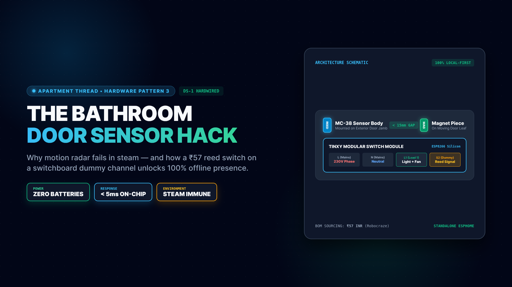
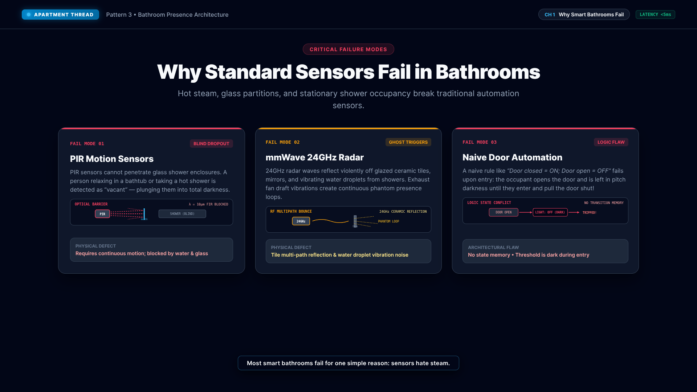
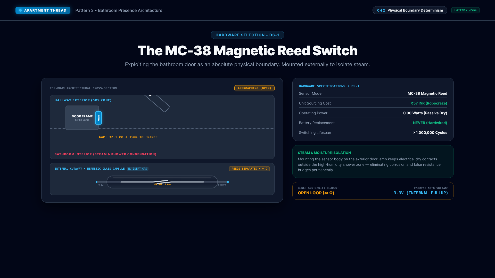
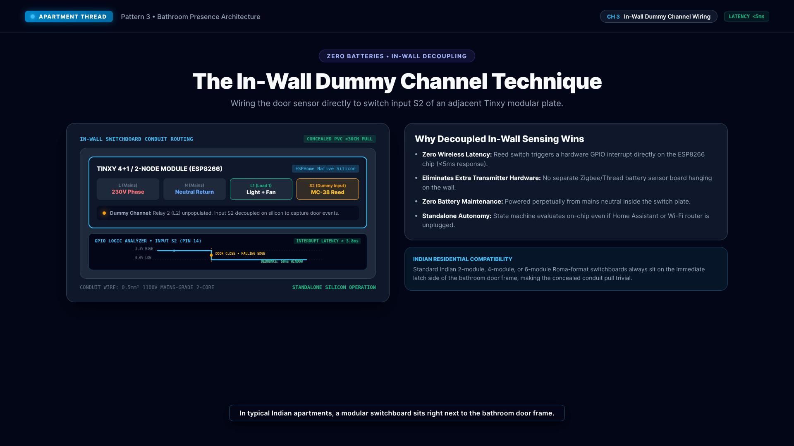
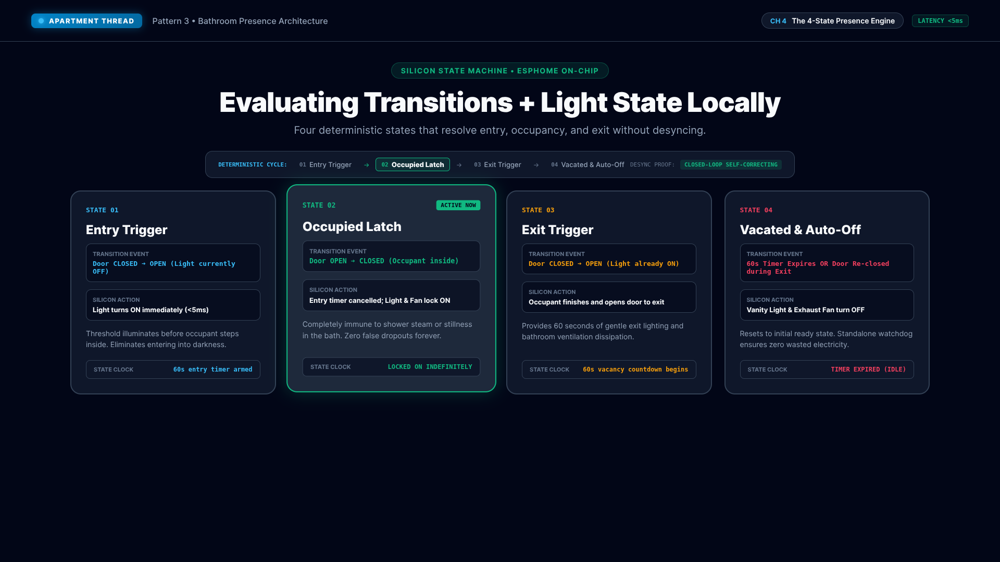
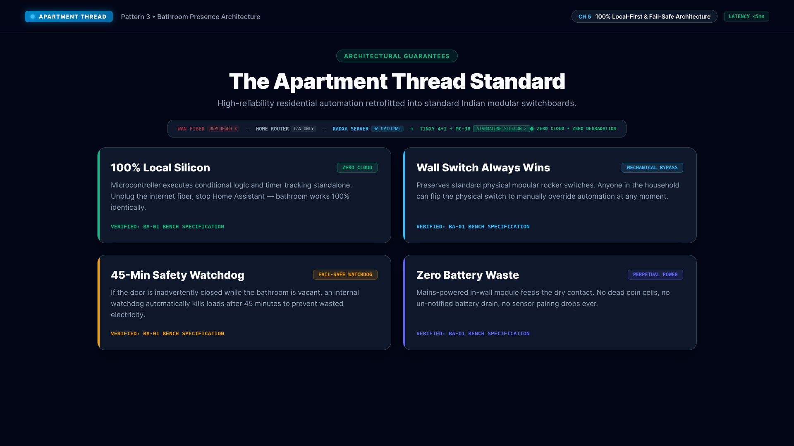

# Bathroom Pattern Explainer Video (16:9 YouTube Master)



Explainer video covering the ApartmentThread Bathroom Pattern (BA-01) and the DS-1 Door Contact Sensor.

## Video Overview
- **Preset:** YouTube 16:9 Full HD (1920x1080) @ 30 FPS
- **Duration:** 4,284 frames (142.80 seconds / 2 minutes 22.8 seconds)
- **Audio Voiceover:** Microsoft Edge Neural TTS (`en-IN-PrabhatNeural`)
- **Loudness:** -16.7 LUFS Integrated, -2.0 dBFS Peak (EBU R128 Compliant)
- **Composition ID:** `BathroomPattern`
- **Thumbnail ID:** `BathroomThumbnail`
- **Scene Stills:** `images/scene-*.png` (5 Slide Decks @ 1920x1080)

## Chapters, Sub-Compositions & Timings (30 FPS)
| Chapter | Sub-Composition ID | Title | Frames (Start - End) | Duration (Frames / Seconds) |
|---|---|---|---|---|
| **01** | `BathroomScene1Problem` | Why Smart Bathrooms Fail (PIR & mmWave Trap) | 0 - 765 | 766 frames (25.53s) |
| **02** | `BathroomScene2Sensor` | Physical Boundary Determinism (MC-38 Reed Switch) | 766 - 1633 | 868 frames (28.93s) |
| **03** | `BathroomScene3Wiring` | In-Wall Dummy Channel Wiring (Tinxy S2 Decoupling) | 1634 - 2410 | 777 frames (25.90s) |
| **04** | `BathroomScene4StateMachine` | The 4-State Presence Engine (Sub-5ms Local Logic) | 2411 - 3483 | 1,073 frames (35.77s) |
| **05** | `BathroomScene5LocalFirst` | 100% Local-First & Fail-Safe Architecture | 3484 - 4283 | 800 frames (26.67s) |

## Visual Architecture Gallery
| Scene 1 · Failure Traps | Scene 2 · Physical Boundary |
|:---:|:---:|
|  |  |
| **Scene 3 · In-Wall Wiring** | **Scene 4 · State Machine** |
|  |  |
| **Scene 5 · Local-First HUD** | **Master 1080p Thumbnail** |
|  |  |

## Subtitles & Accessibility
- **Captions (SRT):** `videos/bathroom-pattern/captions.srt` (YouTube Studio / Video Player CC upload)
- **Captions (VTT):** `videos/bathroom-pattern/captions.vtt` (HTML5 Video & WebVTT)
- **Audio Manifest:** `videos/bathroom-pattern/vo/manifest.json` (SHA-256 integrity, frame allocations, and EBU R128 metrics)
- **Burned-in CC:** Rendered in real-time via `SubtitleBanner` in `src/videos/bathroom-pattern/BathroomPattern.tsx`

## Render Commands
- **Thumbnail Still (1920x1080):**
  ```bash
  cd /home/pannet1/programs/github.com/pannet1/make-videos && pnpm run still:bathroom-thumb
  ```
  *(Or `pnpm run still:bathroom-thumb:stop` to export and automatically halt the background Docker container).*
  Output: `out/bathroomthumbnail.png`

- **Standalone Sub-Composition Stills:**
  ```bash
  cd /home/pannet1/programs/github.com/pannet1/make-videos && ./render.sh BathroomScene1Problem --still --frame 50
  cd /home/pannet1/programs/github.com/pannet1/make-videos && ./render.sh BathroomScene2Sensor --still --frame 50
  cd /home/pannet1/programs/github.com/pannet1/make-videos && ./render.sh BathroomScene3Wiring --still --frame 50
  cd /home/pannet1/programs/github.com/pannet1/make-videos && ./render.sh BathroomScene4StateMachine --still --frame 50
  cd /home/pannet1/programs/github.com/pannet1/make-videos && ./render.sh BathroomScene5LocalFirst --still --frame 50
  ```

- **Render All Scene Stills & Thumbnail:**
  ```bash
  cd /home/pannet1/programs/github.com/pannet1/make-videos && pnpm run still:bathroom-scenes
  ```
  *(Or `pnpm run still:bathroom-scenes:stop` to render all stills and immediately halt the background Docker container).*

- **Full Master MP4 Render (User Execution):**
  ```bash
  cd /home/pannet1/programs/github.com/pannet1/make-videos && ./render.sh BathroomPattern out/bathroom-pattern.mp4
  ```
  *(Or `pnpm run render:bathroom:stop` to render and halt the background container automatically).*

- **Fast 540p Draft Render (0.5x scaling):**
  ```bash
  cd /home/pannet1/programs/github.com/pannet1/make-videos && pnpm run render:bathroom-draft
  ```
  *(Or `pnpm run render:bathroom-draft:stop` to render draft and halt the container).*

## Packaging & Distribution Commands
- **Standard Test Runner (Pre-Flight Check):**
  ```bash
  cd /home/pannet1/programs/github.com/pannet1/make-videos && pnpm test
  ```
  *(Runs `pnpm run check:bathroom` — pipeline verification and EBU R128 loudness QC audit).*

- **Full End-to-End Build & Stage Pipeline:**
  ```bash
  cd /home/pannet1/programs/github.com/pannet1/make-videos && pnpm run build:bathroom
  ```

- **Automated Verification:**
  ```bash
  cd /home/pannet1/programs/github.com/pannet1/make-videos && pnpm run verify:bathroom
  ```

- **Quality Control (QC) & Loudness Audit:**
  ```bash
  cd /home/pannet1/programs/github.com/pannet1/make-videos && pnpm run qc:bathroom
  # Or strict post-render inspection requiring video presence:
  pnpm run qc:bathroom:strict
  # Or audit a specific video target:
  ./scripts/qc-bathroom.sh path/to/video.mp4
  ```

- **Audio Manifest Generation & Verification:**
  ```bash
  cd /home/pannet1/programs/github.com/pannet1/make-videos && pnpm run manifest:bathroom
  # Or non-destructive verification:
  pnpm run manifest:bathroom:check
  ```

- **Clean Build & Staging Artifacts (and Stop Background Container):**
  ```bash
  cd /home/pannet1/programs/github.com/pannet1/make-videos && pnpm run clean:bathroom
  ```
  *(Purges `dist/`, ephemeral stills in `out/`, QC directories, and halts the `rendiv` Docker container).*

- **Stop Render Container Directly:**
  ```bash
  cd /home/pannet1/programs/github.com/pannet1/make-videos && pnpm run stop:bathroom
  ```
  *(Halts the `rendiv` background Docker container without purging build or staging artifacts).*

- **Neural Voiceover Re-synthesis:**
  ```bash
  cd /home/pannet1/programs/github.com/pannet1/make-videos && pnpm run vo:bathroom
  ```

- **Audio Timing & Frame Boundary Recalculation:**
  ```bash
  cd /home/pannet1/programs/github.com/pannet1/make-videos && pnpm run timings:bathroom
  ```

- **YouTube Studio Upload Staging & Non-Destructive Bundle Check:**
  ```bash
  cd /home/pannet1/programs/github.com/pannet1/make-videos && pnpm run package:bathroom
  # Non-destructive check of staged bundle integrity:
  pnpm run package:bathroom:check
  # Or stage a custom video render:
  ./scripts/stage-bathroom-package.sh path/to/video.mp4
  ```
  Prepares upload-ready assets in `dist/bathroom-pattern-youtube/`:
  - `00-youtube-metadata.txt` (Title, description, timestamps, and tags)
  - `01-thumbnail-1920x1080.png` (High-contrast 1080p thumbnail)
  - `02-subtitles-en-IN.srt` (YouTube Studio timed CC captions)
  - `02-subtitles-en-IN.vtt` (HTML5 timed WebVTT captions)
  - `04-audio-manifest.json` (SHA-256 integrity, duration, and loudness manifest for all voiceover tracks)
  - `04-edit-decision-list.json` (Edit Decision List for 5 scene cuts and 4 joint transition checks)
  - `05-publishing-guide.md` (Step-by-step YouTube Studio upload runbook, see [PUBLISHING.md](PUBLISHING.md))
  - `06-social-copy.txt` (Multi-platform syndication copy for YouTube Community, Twitter/X, LinkedIn, Reddit, see [SOCIAL_COPY.md](SOCIAL_COPY.md))
  - `07-voiceover-script.md` (Phonetic production script and delivery guide, see [VOICEOVER_SCRIPT.md](VOICEOVER_SCRIPT.md))
  - `08-checksums.sha256` (Cryptographic SHA-256 checksum manifest for all staged bundle files)
  - `scene-stills/` (High-resolution 1080p slide deck for scenes 1 to 5)
  - `03-master-video.mp4` (Symlink to master video once rendered, or `03-draft-video.mp4` for draft encodes)
